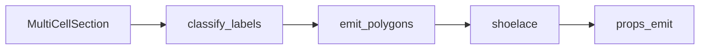

# constructive — polygon path for area and inertia

↑ [`section_geometry`](../README.md)

For mature labels (skin, webs, caps, cores), builds explicit boundary polygons
from the same recipes and integrates area / second moments by shoelace. LE/TE
inserts remain on the SDF residual path. Parity:
[`../docs/reports/DUAL_REP_ACCEPTANCE.md`](../docs/reports/DUAL_REP_ACCEPTANCE.md). Packaging:
[`../props_emit/`](../props_emit/README.md).

Code names such as `emit_laminate_polygons` / `is_laminate_label` mean
**structural wall solids** (skin / web / spar cap), not composite layup —
this package does not bind materials.

## Table of contents

1. [Organisation](#organisation)
2. [API](#api)
3. [Usage in the package](#usage-in-the-package)
4. [See also](#see-also)

---

## Organisation

| File | Role |
|------|------|
| `export.py` | `emit_constructive_polygons` orchestration |
| `emitters.py` | Per-component polygon builders |
| `labels.py` | Constructive vs residual classification |
| `properties.py` | Shoelace moments from polygons |
| `helpers.py` | Shared geometry helpers |

## API

| Name | File | Role |
|------|------|------|
| `emit_constructive_polygons` | `export.py` | Mature labels → polygons |
| Label classifiers | `labels.py` | Constructive vs residual |
| `section_properties_from_polygons` | `properties.py` | Area and inertia from polygons |

## Usage in the package

## See also

- [`../props_emit/`](../props_emit/README.md)
- [`../docs/reports/DUAL_REP_ACCEPTANCE.md`](../docs/reports/DUAL_REP_ACCEPTANCE.md)
