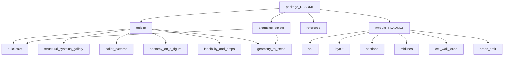

# section_geometry docs

Guides and reference (overview: package README).

↑ [`section_geometry`](../README.md)

## Table of contents

1. [Doc map](#doc-map)
2. [Examples](#examples)
3. [Guides](#guides)
4. [Reference](#reference)
5. [Module pages](#module-pages)

---

## Doc map

## Examples

Runnable teaching scripts (not plot demos):

| Path | Role |
|------|------|
| [`../examples/`](../examples/README.md) | `01`–`05` newcomer path: first station → properties → resolve/size → spanwise anchors → mesh handoff |
| [`../visualisation/demos/`](../visualisation/demos/README.md) | Figure generation / gallery regeneration |

## Guides

| Doc | Contents |
|-----|----------|
| [`quickstart.md`](quickstart.md) | Progressive paths: first call → result → layout → sizing → spanwise webs |
| [`structural_systems_gallery.md`](structural_systems_gallery.md) | All 40 `SYSTEM_TYPE_KEYS` with demo figures |
| [`caller_patterns.md`](caller_patterns.md) | Simple build, sizing loop, spanwise webs |
| [`anatomy_on_a_figure.md`](anatomy_on_a_figure.md) | Labels / midlines / cells on a `"2D-F"` figure |
| [`feasibility_and_drops.md`](feasibility_and_drops.md) | `InfeasibleSectionGeometry` vs dropped webs; `0A`/`0B` handoff |
| [`geometry_to_mesh.md`](geometry_to_mesh.md) | Midlines → `ShellMeshInputs` → `section_mesh` |

## Reference

| Doc | Contents |
|-----|----------|
| [`system_type_xyz_taxonomy.md`](system_type_xyz_taxonomy.md) | Layout-id decode (`"2D-F"` → web count, cap family, orientation) |
| [`figures/`](figures/README.md) | Checked-in figures and regenerate commands |
| [`DUAL_REP_ACCEPTANCE.md`](DUAL_REP_ACCEPTANCE.md) | Polygon vs SDF area acceptance |
| [`PERFORMANCE_WORK_SUMMARY.md`](PERFORMANCE_WORK_SUMMARY.md) | Hybrid / quadtree performance notes |
| [`reports/SG009_JUNCTION_PRIMITIVES_SPIKE.md`](reports/SG009_JUNCTION_PRIMITIVES_SPIKE.md) | SG-009 design spike: post-resample axis x cap junctions |
| [`bug_log.md`](bug_log.md) | Debug log |

## Module pages

| Module | Topic |
|--------|-------|
| [`../api/`](../api/README.md) | Public runner, caller parameters, feasibility |
| [`../tests/`](../tests/README.md) | How to run the package tests |
| [`../layout/`](../layout/README.md) | Layout ids and web cascade |
| [`../sdf/`](../sdf/README.md) | Shape kernel |
| [`../sections/`](../sections/README.md) | `MultiCellSection` |
| [`../sections/components/`](../sections/components/README.md) | Skin / web / cap / core recipes |
| [`../constructive/`](../constructive/README.md) | Polygons for area |
| [`../props_emit/`](../props_emit/README.md) | `properties_map` |
| [`../midlines/`](../midlines/README.md) | Centreline strips |
| [`../topology/`](../topology/README.md) | Junction snap |
| [`../cell_wall_loops/`](../cell_wall_loops/README.md) | Cell-wall loops |
| [`../examples/`](../examples/README.md) | Teaching scripts `01`–`05` |
| [`../visualisation/demos/`](../visualisation/demos/README.md) | Demo run list |
