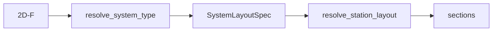

# layout — layout identifiers and web cascade

↑ [`section_geometry`](../README.md)

Resolves a layout id such as `"2D-F"` (web count · spar-cap family ·
orientation) to a frozen `SystemLayoutSpec`, and owns the taper-time web-drop
cascade. Solid assembly is [`../sections/`](../sections/README.md). Decode:
[`../docs/system_type_xyz_taxonomy.md`](../docs/system_type_xyz_taxonomy.md).

Absolute web x-offsets [m from LE] may come from spanwise anchoring. Webs
whose local cavity is too shallow are **dropped**, not slid.
`effective_layout_for_web_count` maps survivors onto a catalogue rung;
`step_down_cascade` returns the ladder.

## Table of contents

1. [Organisation](#organisation)
2. [API](#api)
3. [Usage in the package](#usage-in-the-package)
4. [See also](#see-also)

---

## Organisation

| File | Role |
|------|------|
| `system_layout.py` | `SystemLayoutSpec`, registry, resolve, cascade |
| `structural.py` | Cap-family and fixed-cap-anchor parsers |
| `section_axes.py` | Pitching-axis and max-thickness helpers |
| `thickness_limits.py` | Minimum cavity-depth hints |
| `types.py` | `SDFCallable` protocol |

## API

| Name | File | Role |
|------|------|------|
| `SystemLayoutSpec` | `system_layout.py` | Frozen layout config |
| `resolve_system_type` | `system_layout.py` | String → spec |
| `SYSTEM_TYPE_KEYS` | `system_layout.py` | Registered ids |
| `effective_layout_for_web_count` | `system_layout.py` | Surviving webs → catalogue rung |
| `step_down_cascade` | `system_layout.py` | Ordered drop ladder |
| `StructuralFamily` | `structural.py` | Cap family `"A"`…`"D"` |

### `SystemLayoutSpec` fields

| Field | Meaning |
|-------|---------|
| `key` | Catalogue string (e.g. `"2D-F"`) |
| `n_webs`, `n_cells` | Web and cell counts |
| `has_spar_caps` | Whether caps are present |
| `web_orientation` | `"chord_normal"` or `"flapwise"` |
| `web_positioning` | How default chord fractions are chosen |
| `web_chord_fracs` | Default web stations as fractions of chord from LE |
| `spar_cap_positioning` | Cap anchor policy |
| `geometry_mode` | Catalogue metadata; `"zero_web_catalogue"` on `0A`/`0B` (host is still `MultiCellSection`) |
| `structural_family` | Cap family `"A"`…`"D"` |
| `description` | Human-readable note |

## Usage in the package

Station resolve is orchestrated from [`../api/`](../api/README.md)
(`resolve_station_layout`).

## See also

- [`../docs/system_type_xyz_taxonomy.md`](../docs/system_type_xyz_taxonomy.md)
- [`../sections/`](../sections/README.md)
