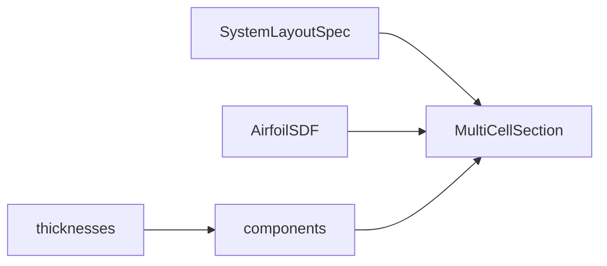

# sections — MultiCellSection assembly

↑ [`section_geometry`](../README.md)

Assembles a layout, aerofoil, and wall thicknesses into a
`MultiCellSection` of named SDF regions. OML is the aerofoil contour; IML is
that contour offset by skin thickness. Twist is stored for emit; component IR
is authored untwisted. Primitives: [`../sdf/`](../sdf/README.md). Layout:
[`../layout/`](../layout/README.md). Thicknesses are geometric — materials are
assigned downstream (`section_bind`).

## Table of contents

1. [Organisation](#organisation)
2. [API](#api)
3. [Usage in the package](#usage-in-the-package)
4. [Components](#components)
5. [See also](#see-also)

---

## Organisation

| Path | Role |
|------|------|
| `multicell.py` | `MultiCellSection` host (all catalogue keys, N ≥ 0 webs) |
| `from_layout.py` | `multicell_from_layout` — layout + thicknesses → host |
| `components/` | Part recipes — [`components/README.md`](components/README.md) |
| `labels.py` | `ComponentLabel` |
| `clips.py` | Placement half-planes / strips |
| `build_spar_caps.py` | Cap-family A–D placement |
| `web_layout.py` | Web anchor resolution |
| `cap_feasibility.py` | Skip caps that do not fit |

## API

| Name | File | Role |
|------|------|------|
| `MultiCellSection` | `multicell.py` | Assembled named regions (sole production host) |
| `multicell_from_layout` | `from_layout.py` | Layout → MultiCell for any `SYSTEM_TYPE_KEYS` entry |
| Component classes | `components/*.py` | Per-part recipes |
| `ComponentLabel` | `labels.py` | Stable region names |

### Host surface

`MultiCellSection` behaves like a mapping of label → component and satisfies
the midline host protocol used by emit:

| Member | Role |
|--------|------|
| `labels` | List of active region names |
| `section[label]` / `eval(label, x, y)` | Evaluate one region’s SDF |
| `eval_all` / `eval_union` | Batch / union evaluation |
| `components` | Active (possibly twisted) component map |
| `components_unrotated` | Chord-frame skin / web / core map for midlines |
| `spar_cap_components_unrotated` | Chord-frame spar-cap map |
| `airfoil`, `twist_rad`, `structural_family` | Host metadata |
| `n_webs`, `n_cells` | Derived counts |
| `twin_web` / `d_spar` / `torsion_box` | Convenience constructors |

### Typical labels

| Pattern | Meaning |
|---------|---------|
| `skin_suction_surface`, `skin_pressure_surface` | Suction / pressure skin |
| `shear_web_0`, `shear_web_1`, … | Shear webs (LE → TE) |
| `spar_cap_suction_surface`, `spar_cap_pressure_surface` | Cap pair (family B/C/D) |
| `sandwich_core_0`, … | Sandwich-core bays |
| `leading_edge_insert`, `trailing_edge_insert` | Optional tip inserts |

Exact keys depend on layout family and whether cores / inserts are enabled.
Sandwich **cores** are on by default for multicell builds; **LE/TE inserts**
are optional and off unless the layout/recipe enables them. After topology,
skin midlines may use hierarchical panel labels such as
`skin_suction_surface:bay_0`.

## Usage in the package

Downstream modules query the host for SDF evaluation, midline recipes, and
property integration.

## Components

Part recipes (skin, web, cap, core, inserts) and OML/IML:
[`components/README.md`](components/README.md).

## See also

- [`components/README.md`](components/README.md)
- [`../docs/reference/system_type_xyz_taxonomy.md`](../docs/reference/system_type_xyz_taxonomy.md)
- [`../midlines/`](../midlines/README.md)
- [`../constructive/`](../constructive/README.md)
