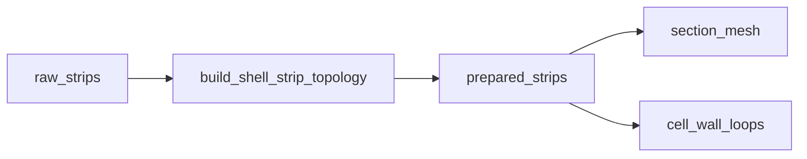

# topology — junction preparation for strips

↑ [`section_geometry`](../README.md)

Snaps and panelises already-emitted twisted strips so web–skin and cap–web
junctions share coincident endpoints for meshing. Merges feet within
tolerances, splits skin arcs, and inserts cap–web T-junctions where required.
Prepared strips differ from raw emit; `cell_wall_loops` and mesh consumers
should use the prepared form.

## Table of contents

1. [Organisation](#organisation)
2. [API](#api)
3. [Usage in the package](#usage-in-the-package)
4. [See also](#see-also)

---

## Organisation

| File | Role |
|------|------|
| `shell_strip_topology.py` | Main snap / panelise pass |
| `cap_web_junctions.py` | Cap–web T-junction insert (axis × final cap) |
| `../midlines/junction_primitives.py` | Shared axis × offset-ring oracle; production web feet use it |
| `../midlines/cap_skin_ray_resample.py` | Cap ray resample; preserves pre-resample junction seeds |

## API

| Name | File | Role |
|------|------|------|
| `build_shell_strip_topology` | `shell_strip_topology.py` | Raw → prepared strips |
| `ShellStripTopologySpec` | `shell_strip_topology.py` | Tolerances / options |

## Usage in the package

## See also

- [`../midlines/`](../midlines/README.md)
- [`../cell_wall_loops/`](../cell_wall_loops/README.md)
